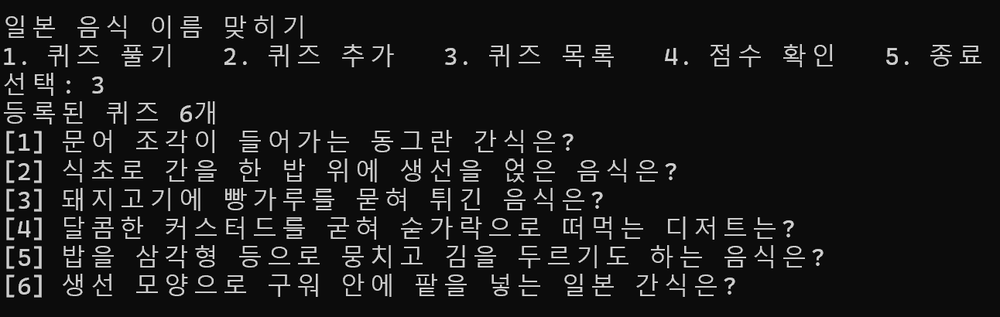
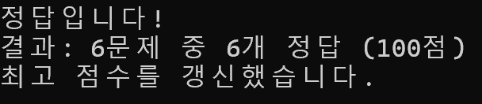
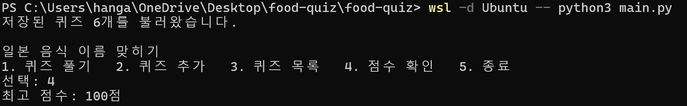
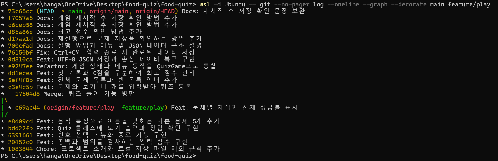

# 일본 음식 이름 맞히기

음식의 특징을 읽고 네 가지 보기에서 이름을 고르는 파이썬 콘솔 게임입니다. 여행이나 식당에서 접하는 익숙한 음식으로 문제를 구성해 누구나 바로 풀 수 있도록 했습니다.

[개발 과정과 실행 화면 보기](#개발-과정과-실행-화면)

## 실행

Python 3.10 이상이 필요합니다. 프로젝트 폴더의 터미널에서 실행하세요. 추가 패키지 설치는 필요 없습니다.

```bash
python3 main.py
```

Windows PowerShell에서는 `py -3 main.py`로도 실행할 수 있습니다.

## 메뉴

| 번호 | 기능 | 동작 |
|---|---|---|
| 1 | 풀기 | 모든 문제에 답하면 정답 수와 100점 만점 점수를 표시합니다. |
| 2 | 추가 | 문제, 보기 네 개, 정답 번호를 입력하면 곧바로 저장합니다. |
| 3 | 목록 | 등록된 문제 제목을 차례로 보여줍니다. |
| 4 | 점수 | 완료한 게임 중 가장 높은 점수를 표시합니다. |
| 5 | 종료 | 저장할 변경 사항을 확인하고 종료합니다. |

점수는 정답 수를 전체 문제 수로 나눈 뒤 100을 곱해 정수로 반올림합니다. 게임 도중 종료하면 그 판의 점수는 기록하지 않습니다.

## 파일 구조

| 파일 | 역할 |
|---|---|
| main.py | QuizGame 클래스, 메뉴, 풀이, 점수와 파일 관리 |
| quiz.py | Quiz 클래스, 한 문제의 보기 출력과 정답 판정 |
| inputs.py | 공백 제거, 빈 입력 및 번호 범위 검사, 재입력 |
| questions.py | 첫 실행에 사용하는 기본 문제 5개 |
| state.json | 프로그램이 프로젝트 루트에 생성하는 개인 기록 |

## 저장 데이터

`main.py`와 같은 폴더에 UTF-8로 저장합니다. `quizzes`의 각 항목에 문제, 순서대로 나열한 보기 네 개, 1부터 시작하는 정답 번호가 들어갑니다. `best_score`는 첫 게임 전에는 null, 이후에는 0~100의 정수입니다.

```json
{
  "quizzes": [
    {
      "question": "문어 조각이 들어가는 동그란 간식은?",
      "choices": ["당고", "타코야키", "푸딩", "모찌"],
      "answer": 2
    }
  ],
  "best_score": null
}
```

파일이 없으면 기본 문제로 시작합니다. 데이터 형식이 손상되면 안내 후 기본 상태로 복구합니다. 쓰기 오류가 발생하면 화면에 표시합니다. 개인 플레이 기록은 Git에서 제외합니다.

목록에서 방금 등록한 문제를 확인하고 게임을 다시 실행하면 저장 여부를 확인할 수 있습니다.

5번으로 종료한 뒤 다시 실행하면 저장된 퀴즈와 최고 점수를 확인할 수 있습니다.

## 개발 과정과 실행 화면

메뉴와 입력 검사를 먼저 만들고, 문제 하나를 표현하는 `Quiz` 클래스로 기본 문제 5개를 작성했습니다. 풀이 기능은 `feature/play` 브랜치에서 개발해 병합했습니다. 이후 `QuizGame`에 등록·목록·점수 관리를 모으고 JSON 저장과 복구를 연결했습니다.

### 1. 개발환경 확인

Windows PowerShell에서 WSL의 Ubuntu를 실행해 Python 3.14.4, Git 2.53.0과 커밋 작성자 설정을 확인했습니다.


### 2. 새 퀴즈 등록

메뉴 2에서 생선 모양의 팥 간식을 묻는 문제와 보기 네 개를 입력했습니다. 정답은 3번 타이야키입니다.


### 3. 목록에서 등록 확인

메뉴 3을 열자 기본 문제 다섯 개에 방금 등록한 문제가 더해져 여섯 번째 항목에 표시됐습니다.



### 4. 여섯 문제 풀기

메뉴 1에서 여섯 문제를 모두 맞혀 100점을 받았습니다. 게임은 정답 수와 점수를 표시하고 최고 점수를 갱신했습니다.



### 5. 재실행 후 기록 확인

게임을 종료한 뒤 다시 실행하자 저장된 퀴즈 6개를 불러왔습니다. 메뉴 4에서도 최고 점수 100점을 확인했습니다.



### 6. 별도 폴더에 복제

`git clone`으로 GitHub 저장소를 `food-quiz-practice`에 복제했습니다. 복제본에서 README에 재실행 안내를 추가하고 커밋한 뒤 `git push`로 올렸습니다.


### 7. 원래 폴더에 변경 반영

원래 작업 폴더에서 `git pull --ff-only`로 변경을 받아왔습니다. `tail -n 1 README.md`로 복제본에서 작성한 문장이 반영됐는지 확인했습니다.


### 8. 브랜치 병합 이력 확인

`feature/play`에서 구현한 채점 기능(`c69ac44`)을 `main`에 병합했습니다(`17504d8`). 아래 그래프는 실습을 마친 시점의 커밋 19개를 보여줍니다.


