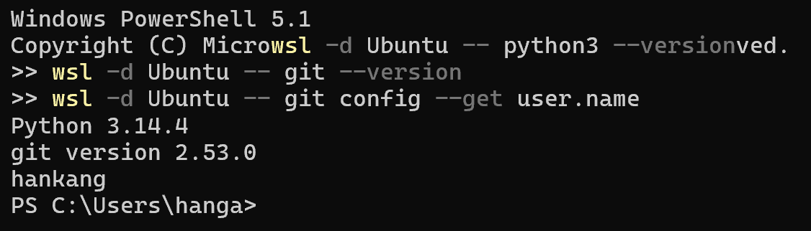
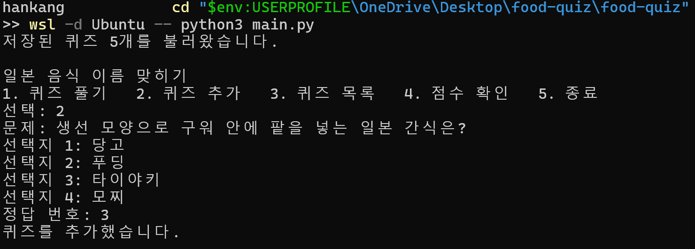
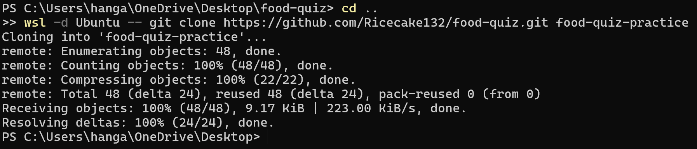
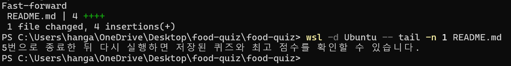

# 일본 음식 이름 맞히기

음식의 특징을 읽고 네 가지 보기에서 이름을 고르는 파이썬 콘솔 게임입니다. 여행이나 식당에서 접하는 익숙한 음식으로 문제를 구성해 누구나 바로 풀 수 있도록 했습니다.

[평가 항목별 확인](#평가-항목별-확인) · [개발 과정과 실행 화면 보기](#개발-과정과-실행-화면)

## 실행

Python 3.10 이상이 필요합니다. 프로젝트 폴더의 터미널에서 실행하세요. 추가 패키지 설치는 필요 없습니다.

```bash
python3 main.py
```

Windows PowerShell에서는 `py -3 main.py`로도 실행할 수 있습니다.

## 메뉴

| 번호 | 기능 | 동작 |
|---|---|---|
| 1 | 풀기 | 모든 문제에 답하면 정답 수와 100점 만점 점수를 표시합니다. |
| 2 | 추가 | 문제, 보기 네 개, 정답 번호를 입력하면 곧바로 저장합니다. |
| 3 | 목록 | 등록된 문제 제목을 차례로 보여줍니다. |
| 4 | 점수 | 완료한 게임 중 가장 높은 점수를 표시합니다. |
| 5 | 종료 | 저장할 변경 사항을 확인하고 종료합니다. |

점수는 정답 수를 전체 문제 수로 나눈 뒤 100을 곱해 정수로 반올림합니다. 게임 도중 종료하면 그 판의 점수는 기록하지 않습니다.

## 파일 구조

| 파일 | 역할 |
|---|---|
| main.py | QuizGame 클래스, 메뉴, 풀이, 점수와 파일 관리 |
| quiz.py | Quiz 클래스, 한 문제의 보기 출력과 정답 판정 |
| inputs.py | 공백 제거, 빈 입력 및 번호 범위 검사, 재입력 |
| questions.py | 첫 실행에 사용하는 기본 문제 5개 |
| state.json | 프로그램이 프로젝트 루트에 생성하는 개인 기록 |

## 저장 데이터

`main.py`와 같은 폴더에 UTF-8로 저장합니다. `quizzes`의 각 항목에 문제, 순서대로 나열한 보기 네 개, 1부터 시작하는 정답 번호가 들어갑니다. `best_score`는 첫 게임 전에는 null, 이후에는 0~100의 정수입니다.

```json
{
  "quizzes": [
    {
      "question": "문어 조각이 들어가는 동그란 간식은?",
      "choices": ["당고", "타코야키", "푸딩", "모찌"],
      "answer": 2
    }
  ],
  "best_score": null
}
```

파일이 없으면 기본 문제로 시작합니다. 데이터 형식이 손상되면 안내 후 기본 상태로 복구합니다. 쓰기 오류가 발생하면 화면에 표시합니다. 개인 플레이 기록은 Git에서 제외합니다.

목록에서 방금 등록한 문제를 확인하고 게임을 다시 실행하면 저장 여부를 확인할 수 있습니다.

5번으로 종료한 뒤 다시 실행하면 저장된 퀴즈와 최고 점수를 확인할 수 있습니다.

## 평가 항목별 확인

### 1. 기능 동작 검증

| 확인 항목 | 직접 확인하는 방법 | 확인할 결과 |
|---|---|---|
| 메뉴와 기본 문제 | 처음 실행한 폴더에서 메뉴 3 선택 | 메뉴 다섯 개와 기본 문제 다섯 개. 기본 문항은 [questions.py](questions.py)에서 확인할 수 있습니다. |
| 입력 검증 | 메뉴에 공백만 입력 → `abc` → `9` → 앞뒤 공백을 붙인 ` 4 ` 입력. 풀이 중에는 정답 번호에 `0` 입력 | 빈 값·문자·범위 밖 번호는 안내 후 같은 항목을 다시 묻습니다. 앞뒤 공백이 있는 유효한 번호는 받아들입니다. |
| 정답·오답과 점수 | 기본 5문제 상태에서 일반 실행 후 차례로 `2, 2, 3, 4, 2` 입력 | 2번 문제에서 오답과 정답 ‘1번 스시’를 표시합니다. 나머지 네 문제를 맞혀 80점입니다. |
| 등록·저장·재실행 | 메뉴 2에서 문제를 추가하고 3에서 확인 → 한 판 완료 → 5로 종료 → 재실행 후 3과 4 선택 | 캡처에서는 추가한 타이야키 문제가 6번째에 남았고 최고 점수 100점도 유지됐습니다. |
| Git 이력 | `git log --oneline --graph --decorate --all` 실행 | 캡처 당시 커밋 19개. `feature/play`의 `c69ac44`와 병합 커밋 `17504d8`을 확인할 수 있습니다. |
| 복제·동기화 | 아래 실행 화면 6~7 확인 | 별도 폴더에 clone한 뒤 README를 수정·push했고, 원래 폴더에서 pull한 마지막 문장까지 확인했습니다. |

### 2. 코드 구조와 설계

- **한 문제와 한 판의 책임.** [Quiz](quiz.py)는 한 문제의 문장·선택지·정답 번호를 보관하고 `display()`와 `is_correct()`로 출력·판정합니다. [QuizGame](main.py)은 문제 목록과 최고 점수를 보관하고, `run()`에서 메뉴를 받아 `play()`, `add_quiz()`, `list_quizzes()`, `show_score()`를 호출합니다.
- **입력과 채점의 경계.** [read_text()와 read_number()](inputs.py)가 공백 제거, 숫자 변환, 범위 검사, 재입력을 맡습니다. 따라서 메뉴와 정답 입력이 같은 규칙을 쓰고, `play()`에는 정답 수를 세고 최종 점수를 계산하는 흐름이 남습니다.
- **읽고 쓰는 순서.** 시작할 때 `QuizGame()`으로 기본 문제를 만든 뒤 `load()`로 JSON을 읽고 필드 검증을 통과하면 저장 상태를 적용합니다. 문제 등록이나 최고 점수 갱신 시 `dirty`를 켜고 `save()`를 호출합니다. 같은 폴더에 UTF-8 임시 파일을 완성한 뒤 `replace()`로 교체하고, 성공하면 `dirty`를 끕니다.
- **안전 종료.** Ctrl+C는 `KeyboardInterrupt`, 입력 스트림의 끝은 `EOFError`로 처리합니다. 진입점의 `except`가 종료 안내를 출력하고 `finally`가 저장을 시도합니다. 새 문제는 모든 입력이 끝난 뒤 추가하고, 점수는 한 판을 끝낸 뒤 갱신하므로 입력 도중 중단한 내용은 미완성 기록으로 남지 않습니다.
- **커밋 단위.** 메뉴, Quiz 클래스, 기본 문제, 풀이, 등록, 목록, 점수, 저장을 기능 단위로 기록했습니다. `Feat`는 기능 추가, `Fix`는 오류 수정, `Refactor`는 책임 재배치, `Docs`는 사용법과 증빙을 담습니다.

### 3. 핵심 기술 원리

| 질문 | 이 프로젝트에서의 답 |
|---|---|
| 왜 클래스를 사용했나요? | 함수만으로도 구현할 수 있지만 문제·보기·정답을 매번 함께 전달해야 합니다. `Quiz` 한 객체로 묶으면 해당 문제의 정답을 `quiz.is_correct(number)`로 판정할 수 있습니다. `self`는 그 호출을 받은 객체를 가리킵니다. |
| 왜 JSON인가요? | 파이썬 표준 라이브러리로 읽고 쓸 수 있고 사람이 내용을 확인할 수 있습니다. 목록과 딕셔너리를 배열·객체로 옮기기 쉽습니다. 클래스 인스턴스는 `to_dict()`로 변환하고 읽을 때 `from_dict()`로 검증·복원합니다. |
| 왜 예외 처리가 필요한가요? | 첫 실행에는 파일이 없고, 파일이 있어도 JSON 문법이나 필드가 틀릴 수 있습니다. 읽기 권한이 없거나 저장 공간이 부족할 수도 있습니다. 누락 시 기본값으로 시작하고, 손상 시 초기화를 안내하며, 읽기·쓰기 실패는 오류 내용을 표시합니다. 쓰기 실패 때는 `dirty`가 남아 종료 시 다시 저장을 시도할 수 있습니다. |
| 브랜치와 병합은 무엇을 했나요? | `feature/play`에서 풀이를 구현하며 별도의 커밋을 쌓았습니다. 병합은 그 변경을 `main`에 합치는 작업입니다. 병합 커밋에 두 부모가 있어 그래프에서 작업 경로가 보입니다. |
| 왜 이 필드와 중첩 구조인가요? | `quizzes`는 문제 순서를, 각 문제의 `choices`는 보기 순서를 보존합니다. `answer`는 화면과 같은 1부터 시작하는 정수입니다. `best_score`는 게임 전체 기록이라 문제 목록과 같은 최상위에 둡니다. `null`은 아직 완주하지 않은 상태, `0`은 완주하고 모두 틀린 기록입니다. |

### 4. 심층 인터뷰

**문제가 1,000개 이상이면 어디가 느려질까요?** 문제 하나를 추가하거나 최고 점수만 바뀌어도 현재 방식은 전체 문항을 다시 직렬화합니다. 시작할 때도 전체 파일을 메모리에 올립니다. 1,000개 자체가 한계는 아니므로 먼저 읽기·저장 시간을 측정합니다. 부분 갱신이나 동시 쓰기가 필요해지면 SQLite에서 문제와 점수를 별도 테이블로 관리하고 변경된 행만 트랜잭션으로 갱신할 수 있습니다.

**손상된 JSON에서 사용자 데이터를 어떻게 지킬 수 있을까요?** 현재 코드는 손상을 안내하고 기본 상태로 복구합니다. 임시 파일 교체는 쓰기 중 원본 손상 가능성을 줄이지만, 이미 손상된 파일은 다음 저장 때 기본 데이터로 대체될 수 있습니다. 개선한다면 먼저 손상 원본을 별도 파일로 보존하고 마지막 정상 백업을 검증합니다. 유효한 백업이 없으면 사용자에게 백업 복원·새 파일로 시작 중 선택권을 줍니다.

**채점 방식이나 보기 수가 바뀌면 어디부터 수정할까요?** 점수 계산은 `QuizGame.play()`의 최종 점수식부터 확인합니다. 점수 체계가 달라지면 `load()`의 0~100 검증과 기존 최고 점수의 비교·이관 기준도 함께 바꿉니다. 보기 수는 `add_quiz()`의 입력 개수, `play()`의 허용 번호, `Quiz.from_dict()`의 길이·정답 범위를 함께 수정합니다. 가변 보기라면 각 문제의 `len(choices)`로 범위를 결정해 기존 4지선다 데이터도 읽도록 할 수 있습니다.

### 5. 보너스 · 랜덤 출제

```bash
python3 main.py --shuffle
```

메뉴 1로 새 게임을 시작할 때마다 문제 목록을 복사해 섞습니다. 모든 등록 문제를 한 번씩 풀며, 보기 순서와 정답 번호는 유지됩니다. 메뉴 3의 목록과 JSON에는 등록 순서가 남습니다. 일반 실행은 등록 순서대로 출제합니다.

## 개발 과정과 실행 화면

메뉴와 입력 검사를 먼저 만들고, 문제 하나를 표현하는 `Quiz` 클래스로 기본 문제 5개를 작성했습니다. 풀이 기능은 `feature/play` 브랜치에서 개발해 병합했습니다. 이후 `QuizGame`에 등록·목록·점수 관리를 모으고 JSON 저장과 복구를 연결했습니다.

### 1. 개발환경 확인

Windows PowerShell에서 WSL의 Ubuntu를 실행해 Python 3.14.4, Git 2.53.0과 커밋 작성자 설정을 확인했습니다.



### 2. 새 퀴즈 등록

메뉴 2에서 생선 모양의 팥 간식을 묻는 문제와 보기 네 개를 입력했습니다. 정답은 3번 타이야키입니다.



### 3. 목록에서 등록 확인

메뉴 3을 열자 기본 문제 다섯 개에 방금 등록한 문제가 더해져 여섯 번째 항목에 표시됐습니다.


### 4. 여섯 문제 풀기

메뉴 1에서 여섯 문제를 모두 맞혀 100점을 받았습니다. 게임은 정답 수와 점수를 표시하고 최고 점수를 갱신했습니다.


### 5. 재실행 후 기록 확인

게임을 종료한 뒤 다시 실행하자 저장된 퀴즈 6개를 불러왔습니다. 메뉴 4에서도 최고 점수 100점을 확인했습니다.


### 6. 별도 폴더에 복제

`git clone`으로 GitHub 저장소를 `food-quiz-practice`에 복제했습니다. 복제본에서 README에 재실행 안내를 추가하고 커밋한 뒤 `git push`로 올렸습니다.



### 7. 원래 폴더에 변경 반영

원래 작업 폴더에서 `git pull --ff-only`로 변경을 받아왔습니다. `tail -n 1 README.md`로 복제본에서 작성한 문장이 반영됐는지 확인했습니다.



### 8. 브랜치 병합 이력 확인

`feature/play`에서 구현한 채점 기능(`c69ac44`)을 `main`에 병합했습니다(`17504d8`). 아래 그래프는 실습을 마친 시점의 커밋 19개를 보여줍니다.


